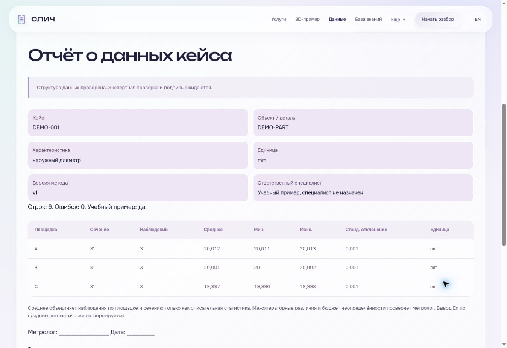

# Аудит СЛИЧ: оформление, содержание и рабочие сценарии

Проверка выполнена 27–28 октября 2026 года. Исходная версия: `426ce2c362fa5e35dcb37928645b834676955676` в [rdavid55/sleech](https://github.com/rdavid55/sleech). Сайт: https://rdavid55.github.io/sleech/.

Последовательность работы: изучение проекта и заявлений → проверка страниц и воспроизведение ошибок → исправления в отдельной ветке → повторная функциональная и визуальная проверка. Стиль Liquid Glass, обе языковые версии и девять 3D-деталей сохранены.

## Исправленные ошибки

| Сценарий | Ошибка и последствие | Исправление и проверка |
| --- | --- | --- |
| После положительного расчёта очистить стоимость спора | Старый положительный вывод оставался рядом с отсутствующим результатом | Вывод заменяется подсказкой, экспорт блокируется. Проверено в браузере и тестом контроллера |
| Очистить месяцы в регулярной смете, затем выбрать разовую услугу | Скрытое поле блокировало корректную разовую смету | Месяцы и циклы проверяются только для регулярного формата; отдельный тест |
| Сравнение без единицы или при переполнении арифметики | Числовой результат мог выглядеть завершённым при неполных условиях либо быть бесконечным | Нет результата и экспорта без единицы; нечисловые и бесконечные результаты отклоняются; проверены условия сравнения |
| После корректного кейса загрузить повреждённый CSV | Ошибка не блокировала экспорт прежних данных как проверенных | Заметное сообщение над вкладками, прежний кейс сохранён; экспорт и печать недоступны до исправления или явного продолжения |
| Импортировать JSON с неполным паспортом | Недостающие поля могли оставаться от предыдущего кейса | Проверяется полный паспорт до изменения формы; неверный файл не меняет текущий кейс |
| Ошибка чтения файла или два импорта подряд | Ошибка чтения могла остаться без понятного ответа; позднее завершение старого чтения могло перезаписать новое | Обработаны ошибки чтения, учитывается порядок выбора; отдельные тесты обратного порядка завершения и прерывания чтения восстановлением черновика |
| Экспортировать отрицательное число с десятичной запятой | Значение `-0,001` получало лишний апостроф | Числа сохраняются, текстовые формулы экранируются; проверены тест и реально скачанный CSV |
| Экспортировать CSV с дополнительной колонкой | Пользовательская колонка терялась | Экспорт сохраняет исходные заголовки и значения; проверены тест и скачанный файл |
| Открыть шаблон CSV | Неэкранированная точка с запятой создавала 19 ячеек при 18 заголовках | Комментарий заключён в кавычки; тест проверяет ширину. Пустая строка шаблона явно описана как заготовка для заполнения |
| Переключить режим хранения несколько раз | Старая временная копия могла заменить более новый сохранённый черновик | При смене режима переносится актуальная версия; устаревшие временные копии удаляются |
| Очистить сохранённые данные | Снимки страниц могли остаться во временном хранилище | Очищаются принадлежащие СЛИЧ черновики и снимки текущей вкладки; результат очистки сообщается честно. Другие данные браузера не затрагиваются |
| Подготовить задачу с пустыми полями | Создавался файл без описания детали и задачи | Поля проверяются до скачивания или копирования; фокус переводится к пропуску |

## Оформление и содержание

- В отчёте технические имена полей заменены понятными подписями RU/EN. Добавлена единица измерения к статистике и расшифровано число наблюдений. Длинные значения переносятся, подписи и результаты стали читабельнее на узком экране.
- Ошибки импорта видны из любой вкладки. Сообщения о состоянии размечены для вспомогательных технологий; удалены повторяющиеся HTML-атрибуты.
- На странице услуг явно указано, что форматы плановые: браузерные инструменты доступны сейчас, экспертные измерения требуют согласования. Плановые цены, гипотезы экономии и неподтверждённая готовность не представлены как доказанные результаты.
- Уточнены подпись порога покрытия платы, точность процента и сообщение о нулевом чистом эффекте. В русской иллюстрации на главной исправлено обозначение миллиметров.
- В пяти PDF исправлены ссылки на действующий GitHub Pages. В трёх копиях презентации обновлён QR-код, название «1С:Метрологическая служба» и добавлен знак ДВФУ только на титульный слайд, сверху по центру. Изменённые страницы отрендерены и просмотрены.
- Обновлены версии общих ресурсов в HTML, чтобы браузер получил исправленные скрипты и стили.

## Проверка

`node --test tests/*.test.cjs` — 26 тестов: 8 геометрии 3D, 8 ядра расчётов и данных, 3 хранения, 7 контроллера интерфейса. Проверки контроллера выполняют реальный скрипт в Node.js с минимальной DOM-фикстурой; это не замена проверке в браузере.

В браузере проверены:

- все 15 страниц RU и 15 страниц EN при ширине 390 px;
- семь основных страниц дополнительно при 320, 768 и 1366 px — всего 51 сочетание страницы и ширины, без горизонтального переполнения документа;
- все девять 3D-деталей, вращение мышью и стрелками, передача учебных значений в сравнение, блокировка без условий и единицы;
- некорректный расчёт после положительного результата, переход между форматами сметы, пустая задача, загрузка учебного примера, отчёт, импорт и экспорт CSV/JSON;
- ошибочный CSV после корректного кейса: прежний кейс сохраняется, проверенный экспорт блокируется, явное продолжение восстанавливает доступ.

Контрольный расчёт: 20 споров × 120 000 ₽ × 30% = 720 000 ₽ потенциальной экономии. При трёх циклах плата первого года — 430 000 ₽, расчётный чистый эффект — 290 000 ₽; при шести спорах — −214 000 ₽. Это модельные исходные данные, не результат пилота.

Также проверены синтаксис изменённых JavaScript-файлов, локальные ссылки и якоря, повторяющиеся HTML-идентификаторы и атрибуты, формат CSV, ссылки внутри PDF и `git diff --check`.

## Границы проверки

Мобильная вёрстка проверена в Chromium через контейнеры соответствующей ширины. Физический iPhone, Safari, реальное касание и жест двумя пальцами не проверялись. QR-код создан для действующего адреса и визуально проверен; отдельное сканирование камерой не выполнялось. Проверка файлов и интерфейса не подтверждает метрологическую методику, производственный пилот или аккредитацию.

Первичные источники для сверки содержания: [1С:Метрологическая служба](https://solutions.1c.ru/catalog/metrology/), [ISO/IEC 17043:2023](https://www.iso.org/standard/80864.html), [ISO/IEC 17025:2017](https://www.iso.org/standard/66912.html), [JCGM 100:2008](https://www.bipm.org/documents/20126/2071204/JCGM_100_2008_E.pdf).
